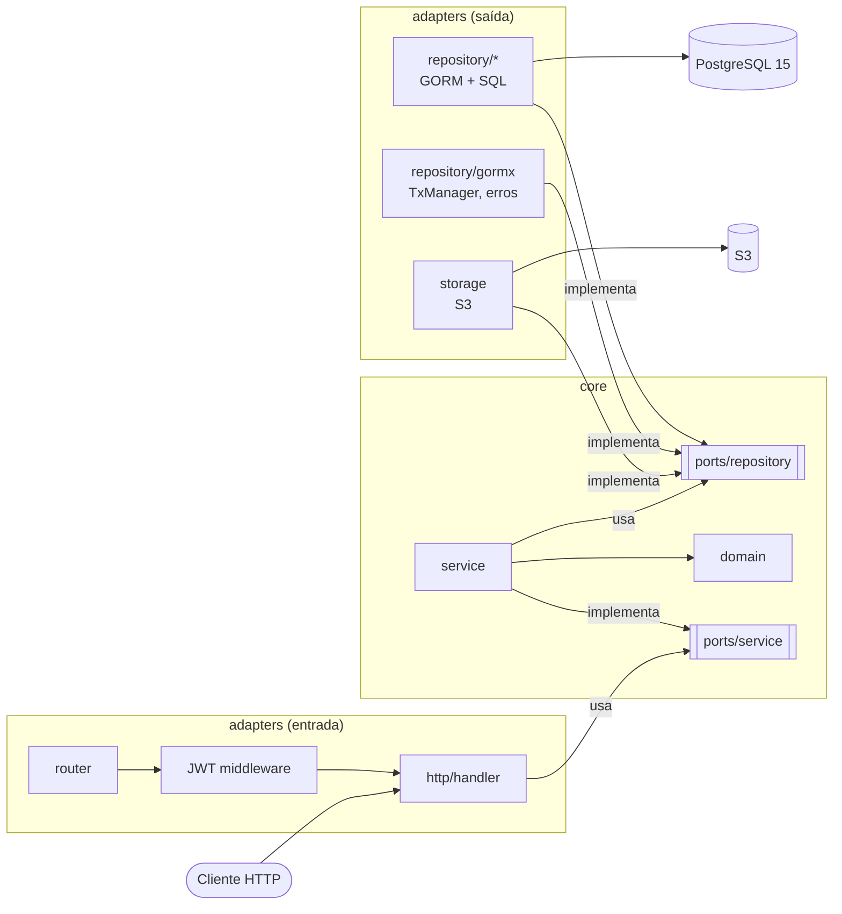

# Elephrases API

API de flashcards com repetição espaçada, voltada ao estudo de idiomas. O usuário organiza cartões em decks, estuda uma fila diária (cartões novos e cartões vencidos) e cada resposta reagenda o cartão.

**Stack:** Go 1.23 · Gin · GORM · PostgreSQL 15 · golang-migrate · Docker Compose · testcontainers-go · Swagger (swaggo)

- Requisitos de produto: [`docs/requirements.md`](docs/requirements.md) e [`requirements.md`](requirements.md)
- Medições de desempenho da fila de estudo: [`docs/performance.md`](docs/performance.md)

## Arquitetura

O projeto segue a arquitetura hexagonal (ports & adapters). O núcleo (`internal/core`) não conhece HTTP, GORM nem Postgres. Ele declara **portas** (interfaces), e os **adapters** as implementam.



| Camada | Pasta | Responsabilidade |
|---|---|---|
| Domínio | `internal/core/domain` | Entidades (`Flashcard`, `Deck`, `Review`, `User`) e regras, como o agendamento em `ReviewFlashcard`. |
| Portas | `internal/core/ports/{service,repository}` | Interfaces de casos de uso e de persistência (`FlashcardRepository`, `ReviewRepository`, `TxManager`, ...). |
| Services | `internal/core/service` | Casos de uso: orquestram domínio e portas. |
| Adapters HTTP | `internal/adapters/{router,middleware,http}` | Rotas Gin, autenticação JWT, DTOs e mapeamento de erros para status HTTP. |
| Adapters de persistência | `internal/adapters/repository` | Implementações GORM das portas, `TxManager` e mapeamento de erros. |

Regra de dependência: `core/domain` e `core/service` não importam GORM, Gin nem nada de `adapters`. A dependência aponta sempre para dentro.

## Persistência

### GORM nos CRUDs, SQL explícito na fila de estudo

As operações de CRUD (decks, cartões, usuários) usam GORM: são consultas simples, e o ORM reduz o código repetitivo.

A fila de estudo (`GET /flashcards/deck/{deckID}/study`) é a consulta mais quente da aplicação e tem lógica própria: contar os cartões revisados hoje, limitar os novos ao que resta do limite diário e ordenar os vencidos. Ela é feita em **uma única query com CTEs** via `db.Raw` (`internal/adapters/repository/flashcards/study_queue.go`), só com parâmetros posicionais (`?`) e sem concatenar strings. O ganho é uma ida ao banco em vez de três e um snapshot consistente entre contagem e listas. Os números estão em [`docs/performance.md`](docs/performance.md).

### Migrations versionadas

O schema é definido apenas por migrations SQL em `database/migrations`, aplicadas com golang-migrate. Toda migration tem `up` e `down`. Migrations já aplicadas não são editadas, e qualquer mudança entra numa migration nova. Os testes de integração aplicam essas mesmas migrations, então o schema testado é o de produção.

### Constraints e índices

| Objeto | Motivo |
|---|---|
| `idx_flashcards_deck_next_review (deck_id, next_review_at)` | Fila de vencidos: `deck_id = ? AND next_review_at <= ?`. Sem ele, cada requisição de estudo fazia Seq Scan na tabela inteira. |
| `idx_flashcards_deck_last_review (deck_id, last_review_at)` | Cartões novos (`last_review_at IS NULL`) e contagem de revisados hoje (`last_review_at >= início do dia`). |
| `idx_reviews_flashcard_reviewed_at (flashcard_id, reviewed_at DESC)` | Histórico de revisões de um cartão, do mais recente ao mais antigo. |
| `chk_flashcards_state` | `state` só aceita `new`, `learning`, `review` e `lapsed`. Um valor inválido vindo de bug ou de escrita manual é recusado pelo banco. |
| `chk_flashcards_ease` | `ease_factor >= 1.3`, o piso do SM-2. Com um fator menor, os intervalos encolheriam indefinidamente. |
| `fk_deck ... ON DELETE CASCADE` | Apagar um deck apaga seus cartões, e as revisões vão junto por cascade. Antes, a exclusão falhava com violação de FK. |
| `decks.user_id` (nullable) | Prepara a posse de decks por usuário sem quebrar dados existentes. A obrigatoriedade virá numa migration futura. |

### Transação na revisão

`POST /flashcards/review` altera o cartão **e** grava uma linha em `reviews`. As duas escritas acontecem numa única transação, por meio da porta `TxManager`:

1. `SELECT ... FOR UPDATE` no cartão, para que revisões concorrentes do mesmo cartão sejam serializadas e não se sobrescrevam;
2. `ReviewFlashcard` aplica a resposta;
3. `UPDATE` do cartão;
4. `INSERT` em `reviews`.

Se qualquer passo falhar, tudo é desfeito. A transação viaja no `context.Context`: os repositórios usam `gormx.DB(ctx, db)`, que devolve a transação do context quando ela existe e o `*gorm.DB` padrão quando não existe. Assim, o service não conhece GORM.

### Context com timeout

Cada handler deriva do request um `context.WithTimeout` (`CONTEXT_TIMEOUT`, em segundos), e esse context é propagado pelos services até `db.WithContext(ctx)`. Se o cliente desconectar ou o tempo estourar, a query é cancelada no Postgres em vez de seguir consumindo conexão. `gorm.ErrRecordNotFound` vira `pkg.ErrNotFound`, e a API responde 404.

### Pool de conexões

Configurado em `config.NewPostgresDatabase` a partir do `.env`:

| Variável | Padrão | Efeito |
|---|---|---|
| `DB_MAX_OPEN_CONNS` | 25 | Teto de conexões abertas, que protege o Postgres sob carga. |
| `DB_MAX_IDLE_CONNS` | 10 | Conexões mantidas ociosas para reuso. |
| `DB_CONN_MAX_LIFETIME_MIN` | 30 | Recicla conexões antigas, útil atrás de balanceadores e em failover. |
| `DB_CONN_MAX_IDLE_TIME_MIN` | 5 | Fecha conexões ociosas há muito tempo. |

Na inicialização, um `PingContext` com timeout de 5 s encerra a aplicação com uma mensagem clara se o banco não responder. O logger do GORM fica em `Warn`, com `SlowThreshold` de 200 ms, e registra as queries lentas.

## Como rodar

### Docker Compose

```bash
cp .env.example .env
# No .env, para o compose: DB_HOST=db e DB_PORT=5432; defina DB_PASS e os segredos de token.
docker compose up --build
```

O compose sobe o Postgres, espera o healthcheck, aplica as migrations (serviço `migrate`) e só então inicia a API em `http://localhost:8081`.

### Local (API fora do Docker)

```bash
cp .env.example .env      # DB_HOST/DB_PORT apontando para o seu Postgres
make migrate-up           # aplica as migrations (golang-migrate via go run)
make run                  # sobe a API
```

### Testes

```bash
make test               # unitários: domínio e services (mocks com testify)
make test-integration   # unitários + repositórios contra Postgres 15 real (requer Docker)
```

Os testes de integração ficam atrás da build tag `integration` e sobem um Postgres 15 com testcontainers, aplicando as migrations reais. O CI (`.github/workflows/ci.yml`) roda `go vet`, os testes unitários e os de integração.

### Swagger

Com a API rodando: **http://localhost:8081/swagger/index.html**

### Bruno

A pasta [`bruno/`](bruno) é uma collection do [Bruno](https://www.usebruno.com) com todas as rotas. Abra a pasta no Bruno, selecione o ambiente `local` e rode `Auth/Register` ou `Auth/Login`: o token e os ids (`deckId`, `flashcardId`, `userId`) são guardados automaticamente pelas requests de criação.
